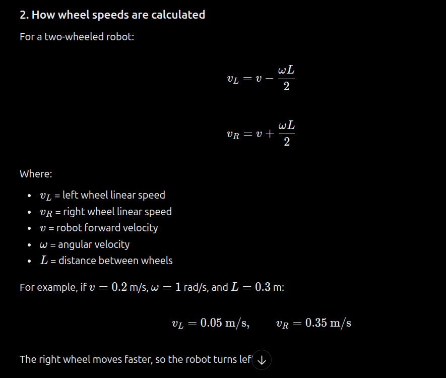

# ROS 2 Jazzy — Robotics Learning Roadmap

A hands-on, beginner-friendly guide to learning ROS 2 Jazzy, robot simulation, control, perception, SLAM, and autonomous navigation.

## About This Repository

This repository documents my journey learning ROS 2 through practical robotics experiments using Ubuntu 24.04, ROS 2 Jazzy, Gazebo, RViz2, and Raspberry Pi 4.

Each tutorial explains:
- **What** the technology is
- **Why** it is needed
- **How** to implement it
- How to verify and troubleshoot it
- How it is used in real-world robotics

## Prerequisites

Before starting, make sure you have:

- Ubuntu 24.04 on a laptop or desktop
- Basic Linux terminal and command-line skills
- Basic Python knowledge
- Git installed
- A working internet connection for installing ROS 2 packages

No previous ROS 2 experience is required. The first lesson guides you through
the system checks and ROS 2 setup.

## Getting started

On an Ubuntu 24.04 laptop, install the basic ROS 2 tools and create a workspace:

```bash
sudo apt update
sudo apt install ros-jazzy-desktop python3-colcon-common-extensions

source /opt/ros/jazzy/setup.bash
mkdir -p ~/ros2_ws/src
cd ~/ros2_ws
colcon build
source install/setup.bash
ros2 doctor --report
```

Then continue with [System configuration](docs/01-sys-config.md). It explains
the laptop and Raspberry Pi setup in more detail.

## Demo

The roadmap builds a simulated mobile robot in Gazebo and visualizes its state
and sensor data in RViz2.



## Learning path

Follow the lessons in order. Each lesson links to the next one so you can continue
without returning to this page.

1. [System configuration](docs/01-sys-config.md)
2. [ROS 2 fundamentals](docs/02-ros2-fundamentals.md)
3. [Services](docs/services.md)
4. [Actions](docs/actions.md)
5. [Parameters](docs/parameters.md)
6. [Launch files](docs/launch-file.md)
7. [Introduction to TF2](docs/tf2.md)
8. [Dynamic TF broadcaster](docs/dynamic-tf.md)
9. [Visualizing TF2 in RViz2](docs/rviz2.md)
10. [URDF: Create your first robot model](docs/urdf.md)
11. [Xacro: Simplify URDF](docs/xacro.md)
12. [Add mass, inertia, and collision to URDF](docs/mass-inertia-collision.md)
13. [Gazebo simulation](docs/05-gazebo.md)
14. [Spawn your robot in Gazebo](docs/06-gazebo-spawn.md)
15. [Make your robot move in Gazebo](docs/07-gazebo-movement.md)
16. [Control Gazebo with ROS 2](docs/08-gazebo-ros2-control.md)
17. [Odometry, TF2, and RViz2 integration](docs/odometry-integration.md)
18. [TF2 and coordinate transformations](docs/coordinate-transformations.md)
19. [ros2_control](docs/ros2-control.md)
20. [LiDAR fundamentals](docs/lidar.md)
21. [Add a LiDAR sensor to a URDF](docs/lidar-urdf.md)
22. [Configure a Gazebo world for LiDAR](docs/lidar-gazebo-world.md)
23. [Run and debug the LiDAR simulation](docs/lidar-operation.md)

## Goal

To provide reproducible, practical tutorials for students, robotics enthusiasts, and developers getting started with ROS 2.

*This is an independent learning resource, not official ROS documentation.*
*The repository is available under the [MIT License](LICENSE).*
