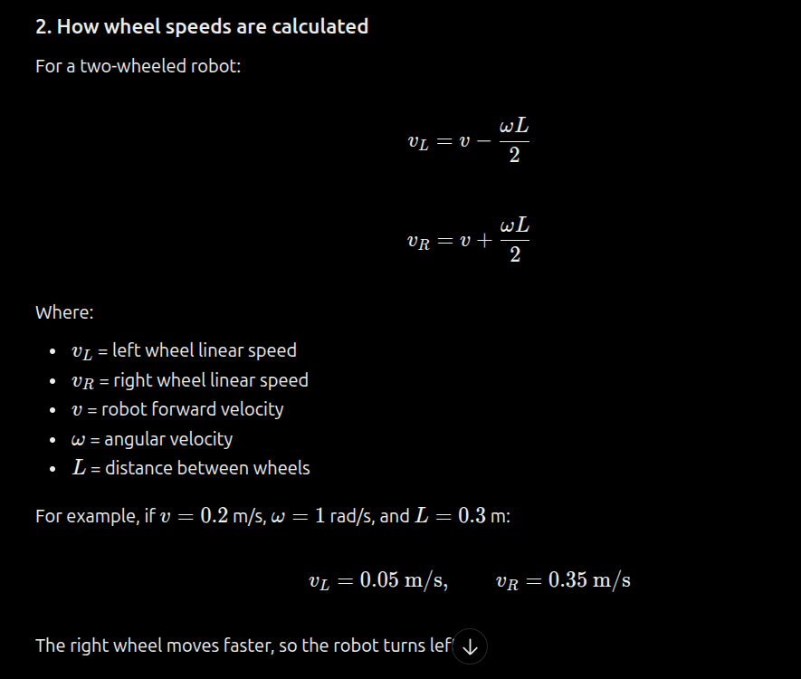
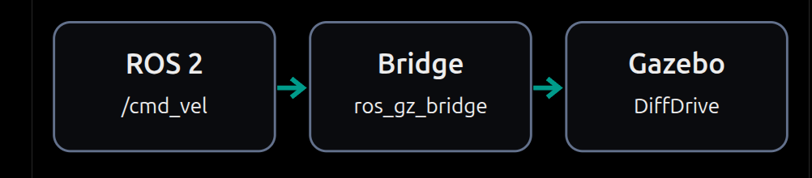
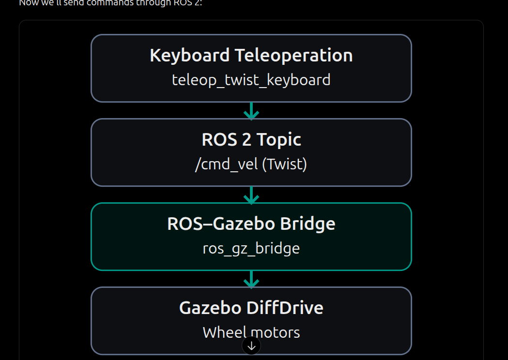

# Gazebo Simulation

URDF + RViz completed

Since your robot model is now visible in RViz and its joints move using the sliders, the next topic is **Gazebo Simulation**.

Until now, we have visualized a robot. Next, we will make it interact with a simulated physical world.

## **1. What is Gazebo?**

[ROS2 Jazzy Tutorial: Develop and Control Gazebo Model of Mobile Robot in ROS2 and Python – Fusion of Engineering, Control, Coding, Machine Learning, and Science](https://images.openai.com/static-rsc-4/Rauw_KUbR_xa3C_SYNXTfKyuhHziOWNRlY1xzpnDFLWw6d3XvSshVEubnpb5Z5vv4fcxcd7tn18vseZ1OqKYHiuigxKbQJuBvPQNq6DjWLpPvz4AudhKhgbfmP4LI5Jlv_5IAlRHouIwEDHpGvZxTSd4fNUIu5dSJKVarVRwHWc?purpose=inline)

[Install Gazebo for ROS 2 in under a minute | Ubuntu](https://images.openai.com/static-rsc-4/LM5DlWoxJxoiNbaoOMG18wLv0tmm0aGmLbuEfx5ktdbmj-OAMEUfrgxtQIGNvG_6Ktzc5Y_1whqiXPVjCvMBvdwx0WQPAscB3fQGgZlvXwqoQNbfsR74iV0wqANoyAXQm3lZA_pt4ZmjsUca5iuWuyKXpeyQZFp8Sq7hYVqGnoo?purpose=inline)

[Additional Simulation Worlds — Dingo Tutorials 0.0.5 documentation](https://images.openai.com/static-rsc-4/bU70pUiOEnBnmkFhvzvUYMPYa55Zs3_UjXlrdCHsgZ--9ahbYo3JQj2lEOAbh3wZK60BWkCI5v8d_NFKdVEfODOibYL0RmvkiXg0LjyU3rx2R687dj-kHOexFjYORSMV-Ys7DBfEcuDpUECFMjb_fXkHRoHL1KWEsdjtYTYi1CU?purpose=inline)

9

Gazebo is a robotics simulator that provides:

- **Physics:** Gravity, friction, collisions and motion.
    
- **Sensors:** LiDAR, cameras, IMU and other simulated sensors.
    
- **Robot control:** Simulated motors and wheel movement.
    
- **Environment:** Floors, walls and obstacles.
    
- **ROS 2 integration:** Communication between Gazebo and ROS 2 nodes.
    

### **RViz vs Gazebo**

|RViz|Gazebo|
|---|---|
|Visualization tool|Physics simulator|
|Displays robot model|Simulates robot movement|
|Displays TF and sensor data|Generates simulated sensor data|
|No physics simulation|Gravity and collision physics|
|Useful for debugging|Useful for testing robot behavior|

## **2. Our learning roadmap**

1. **Install Gazebo Harmonic** — compatible with ROS 2 Jazzy
    
2. **Understand Gazebo architecture** — worlds, models, plugins and simulation
    
3. **Spawn our URDF robot** into Gazebo
    
4. **Add collision and inertial properties** to our robot
    
5. **Implement differential-drive control** for two wheels
    
6. **Integrate ros2****_****control** and controllers
    
7. **Drive using teleop** and keyboard commands
    
8. **Connect Gazebo with RViz** to visualize TF and sensor data
    

## **3. Practical 1 — Install Gazebo Harmonic**

We will run Gazebo on your **Ubuntu 24.04 laptop**, not your headless Raspberry Pi 4, because Gazebo's graphical interface is more suitable for the laptop.

Open a terminal on your laptop.

**Step 1 — Check ROS 2**

```
echo $ROS_DISTRO
```

Expected output:

```
jazzy
```

**Step 2 — Install Gazebo integration**

```
sudo apt update

sudo apt install ros-jazzy-ros-gz
```

This installs the ROS 2 integration packages for Gazebo, including tools for launching Gazebo and exchanging messages.

**Step 3 — Check Gazebo**

```
gz sim --version
```

You should see Gazebo Sim version information.

**Step 4 — Launch an empty world**

```
gz sim empty.sdf
```

[Use ROS 2 to interact with Gazebo — Gazebo harmonic documentation](https://images.openai.com/static-rsc-4/FbjUqfHpfwViVBQKfQ6YElXaZk6BzgjEAFlTAWO5HbXWU_4bJAD68lJjR6KZTbhJy7mTb9CQximl7fB4KmheZAxvtsRZgRVCsOJ68n-vPetQQuMvAyM4UVuSWT-4dtg607GgBhaROxiO2hrEWgFjGJkdYGr-3HfXkdTisCZ4AT4?purpose=inline)

[gazebosim.org](https://gazebosim.org/docs/harmonic/ros2_integration/)

A Gazebo window should open with an empty simulation environment.

## **4. Understand how ROS 2 communicates with Gazebo**

Bidirectional communication between ROS 2 and Gazebo through ros_gz_bridge

The `ros_gz_bridge` package allows messages to pass between ROS 2 topics and Gazebo Transport topics.

For example, ROS 2 can send velocity commands to a simulated robot, while Gazebo can provide odometry and sensor readings back to ROS 2.

## **Your task**

Run these commands on your laptop:

```
gz sim --version
gz sim empty.sdf
```

---

# **ROS 2 Jazzy — Lesson: Spawn Your Robot in Gazebo**

Gazebo installation completed

Now that Gazebo Harmonic is working on your Ubuntu laptop, we will spawn your existing URDF robot inside the simulation.

## **1. What does spawning mean?**

**Spawning** means inserting a robot model into a running simulation.

[ROS2 Jazzy Tutorial: Develop and Control Gazebo Model of Mobile Robot in ROS2 and Python – Fusion of Engineering, Control, Coding, Machine Learning, and Science](https://images.openai.com/static-rsc-4/Rauw_KUbR_xa3C_SYNXTfKyuhHziOWNRlY1xzpnDFLWw6d3XvSshVEubnpb5Z5vv4fcxcd7tn18vseZ1OqKYHiuigxKbQJuBvPQNq6DjWLpPvz4AudhKhgbfmP4LI5Jlv_5IAlRHouIwEDHpGvZxTSd4fNUIu5dSJKVarVRwHWc?purpose=inline)

[aleksandarhaber.com](https://aleksandarhaber.com/ros2-jazzy-tutorial-develop-and-control-gazebo-model-of-mobile-robot-in-ros2-and-python/)

We already have a `robot_description` package containing your URDF model, which we visualized in RViz.

We will reuse that model rather than create a new robot.

## **2. Understand the URDF requirements**

In RViz, we mainly needed:

- `<link>` — defines robot parts.
    
- `<joint>` — connects links.
    
- `<visual>` — describes appearance.
    

Gazebo also needs physical properties:

|URDF element|Purpose|
|---|---|
|`<visual>`|Appearance of the robot|
|`<collision>`|Shape used for collision detection|
|`<inertial>`|Mass and rotational inertia|
|`<joint>`|Connections and motion constraints|

For example, a robot chassis can have:

```xml
<link name="base_link">

  <visual>
    <geometry>
      <box size="0.4 0.3 0.1"/>
    </geometry>
  </visual>

  <collision>
    <geometry>
      <box size="0.4 0.3 0.1"/>
    </geometry>
  </collision>

  <inertial>
    <mass value="5.0"/>
    <inertia
      ixx="0.0417"
      ixy="0.0"
      ixz="0.0"
      iyy="0.0708"
      iyz="0.0"
      izz="0.1042"/>
  </inertial>

</link>
```

Here, the robot chassis is a box measuring 40 × 30 × 10 cm with a mass of 5 kg. The inertia values are approximate values for a uniform box of those dimensions.

## **3. Find your existing URDF**

Open a terminal on your laptop:

```
cd ~/ros2_ws/src/robot_description
```

Check the package contents:

```
ls
```

Find your URDF files:

```
find . -type f \( -name "*.urdf" -o -name "*.xacro" \)
```

You might see something like:

```
./urdf/robot.urdf
```

or:

```
./urdf/robot.urdf.xacro
```

We need the actual file name before proceeding.

## **4. Spawn the robot**

First, make sure Gazebo is running in another terminal:

```
gz sim empty.sdf
```

In a second terminal, source ROS 2:

```
source /opt/ros/jazzy/setup.bash
source ~/ros2_ws/install/setup.bash
```

If your model is a plain URDF file, use:

```
ros2 run ros_gz_sim create \
  -world empty \
  -file ~/ros2_ws/src/robot_description/urdf/robot.urdf \
  -name my_robot \
  -x 0 -y 0 -z 0.5
```

Replace `robot.urdf` with your actual filename.

### **Explanation**

|Parameter|Meaning|
|---|---|
|`create`|Spawn a model into Gazebo|
|`-world empty`|Target the world named `empty`|
|`-file`|Path to robot description|
|`-name my_robot`|Name of the spawned robot|
|`-x 0 -y 0`|Initial horizontal position|
|`-z 0.5`|Initial height of 0.5 m|

The robot starts above the ground. With valid collision and inertial properties, it should fall under gravity and settle on the floor.

If your model is Xacro, it must first be converted to URDF before spawning.

**5. Verify the result**

Once the robot appears, you can inspect the simulation and check whether it interacts with gravity and the floor correctly.

---

## **ROS 2 Jazzy — Next Lesson: Make Your Robot Move in Gazebo**

Robot spawning completed

Your robot is now inside Gazebo. The next step is to **control its wheels and make it move using ROS 2 commands**.

We'll start with differential-drive control using Gazebo's built-in `DiffDrive` system. Later, we'll learn `ros2_control`, which is especially useful when moving from simulation to your Raspberry Pi robot.

## **1. What is differential drive?**

[Robot Kinematics - Team 2928 FRC Training](https://images.openai.com/static-rsc-4/KpEqEMTqh33ZMlkWKdA41q51jla6zhkL_ELPmRT2y4a2mzgaf1v5w8ItMJKdXeOEMYPHAuiWUlnhn0PqpTc9j7Rt8DonqrJx7mGOnOPo2wwKgobhGoUjjLbrM37LCrYfiFwgALSCmZaN-xYeeweez_iDSV172_aalgJ0KDVk9hY?purpose=inline)

[2928-frc-programmer-training.readthedocs.io](https://2928-frc-programmer-training.readthedocs.io/en/latest/Concepts/Dynamics/kinematics/)

A differential-drive robot uses two independently controlled wheels.

|Left wheel|Right wheel|Movement|
|---|---|---|
|Forward|Forward|Move forward|
|Backward|Backward|Move backward|
|Backward|Forward|Rotate left|
|Forward|Backward|Rotate right|
|Stopped|Forward|Turn in an arc|

In ROS 2, we typically command movement using the `/cmd_vel` topic.

The message type is `geometry_msgs/msg/Twist`, containing:

- `linear.x` — forward/backward speed in m/s.
    
- `angular.z` — rotational speed in rad/s.
    


## **3. Add a differential-drive controller**

Open your robot's URDF file.

```
nano ~/ros2_ws/src/robot_description/urdf/robot.urdf
```

If your actual filename is different, use that instead.

Add this block inside the root `<robot>` element, before its closing tag:

```xml
<gazebo>
  <plugin
    filename="gz-sim-diff-drive-system"
    name="gz::sim::systems::DiffDrive">

    <left_joint>left_wheel_link_joint</left_joint>
    <right_joint>right_wheel_link_joint</right_joint>

    <wheel_separation>0.3</wheel_separation>
    <wheel_radius>0.05</wheel_radius>

    <topic>cmd_vel</topic>
    <odom_topic>odom</odom_topic>
    <frame_id>odom</frame_id>
    <child_frame_id>base_link</child_frame_id>

  </plugin>
</gazebo>
```

**Important:** The joint names, wheel radius and separation must match your robot. `0.3` and `0.05` are example values. The two wheel joints must be continuous or otherwise able to rotate.

If your robot uses Xacro, add this to the appropriate Xacro source instead of editing a generated URDF.

## **4. Restart the simulation**

Save your URDF and restart Gazebo:

```bash
gz sim empty.sdf
```

In another terminal, spawn the updated robot again using the same command that worked previously.

The differential-drive plugin runs inside Gazebo, so we can test it directly before connecting ROS 2.

## **5. Test movement**

Open a new terminal.

**Move forward:**

```bash
gz topic -t /cmd_vel \
  -m gz.msgs.Twist \
  -p 'linear: {x: 0.2}, angular: {z: 0.0}'
```

**Rotate left:**

```bash
gz topic -t /cmd_vel \
  -m gz.msgs.Twist \
  -p 'linear: {x: 0.0}, angular: {z: 0.5}'
```

**Stop:**

```bash
gz topic -t /cmd_vel \
  -m gz.msgs.Twist \
  -p 'linear: {x: 0.0}, angular: {z: 0.0}'
```

These commands publish a single velocity message. Because the controller may time out without further messages, use continuous publishing for sustained movement:

```bash
gz topic -t /cmd_vel \
  -m gz.msgs.Twist \
  -p 'linear: {x: 0.2}, angular: {z: 0.0}' \
  -r 10
```

Press `Ctrl+C` to stop publishing. The robot should stop shortly afterward.

## **6. Next: Connect ROS 2 to Gazebo**

Once the wheels move, we will use `ros_gz_bridge` to send actual ROS 2 commands to Gazebo.



---

# Control Gazebo Robot Using ROS 2**

Differential drive working

Your robot now moves in Gazebo using `gz topic`. Next, we'll control it using **ROS 2 topics and keyboard teleoperation**.

## **1. Understand the architecture**

Previously, we sent commands directly to Gazebo:

```
gz topic → Gazebo DiffDrive → Robot
```

Now we'll send commands through ROS 2:

The bridge converts ROS 2 messages into Gazebo Transport messages.

## **2. Install keyboard teleoperation**

On your Ubuntu laptop:

```bash
sudo apt update
sudo apt install ros-jazzy-teleop-twist-keyboard
```


## **3. Start the simulation**

**Terminal 1 — Gazebo**

```
gz sim empty.sdf
```

Spawn your updated robot from another terminal:

```bash
ros2 run ros_gz_sim create \
  -world empty \
  -file /ros2_ws/src/robot_description/urdf/my_robot_generated.urdf \
  -name my_robot \
  -z 0.5
```

## **4. Start the ROS–Gazebo bridge**

**Terminal 2 — Bridge**

```bash
source /opt/ros/jazzy/setup.bash

ros2 run ros_gz_bridge parameter_bridge \
  '/cmd_vel@geometry_msgs/msg/Twist]gz.msgs.Twist'
```

Here:

- `/cmd_vel` is the topic name.
    
- `geometry_msgs/msg/Twist` is the ROS 2 message type.
    
- `gz.msgs.Twist` is the Gazebo message type.
    
- `]` means communication from ROS 2 to Gazebo.
    

The bridge must remain running.

## **5. Start keyboard control**

**Terminal 3 — Teleoperation**

```bash
source /opt/ros/jazzy/setup.bash

ros2 run teleop_twist_keyboard teleop_twist_keyboard \
  --ros-args -p stamped:=false
```

You'll see keyboard controls similar to:

```
Moving around:
   u    i    o
   j    k    l
   m    ,    .

q/z : increase/decrease max speeds
w/x : increase/decrease linear speed
e/c : increase/decrease angular speed
```

Use these keys:

|Key|Action|
|---|---|
|`i`|Move forward|
|`,`|Move backward|
|`j`|Rotate left|
|`l`|Rotate right|
|`k`|Stop|
|`u`|Forward and turn left|
|`o`|Forward and turn right|

Keep the teleoperation terminal focused while pressing keys.

## **6. Verify ROS 2 communication**

Open a fourth terminal:

```
ros2 topic list
```

You should find:

```
/cmd_vel
```

Inspect its message type:

```
ros2 topic info /cmd_vel
```

Expected type:

```
geometry_msgs/msg/Twist
```

To inspect messages:

```
ros2 topic echo /cmd_vel
```

Press `i`, `j` or `l` in the teleoperation terminal and watch the values change.

---

[Next: Odometry, TF2, and RViz2 integration](./odometry-integration.md)
