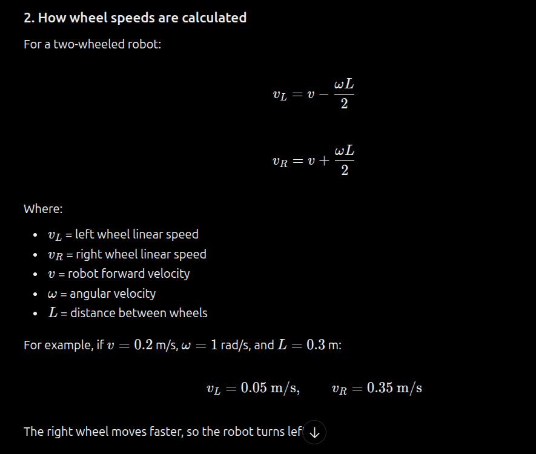
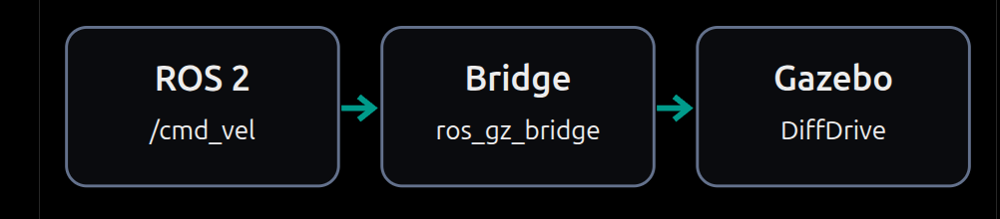

Robot spawning completed

Your robot is now inside Gazebo. The next step is to **control its wheels and make it move using ROS 2 commands**.

We'll start with differential-drive control using Gazebo's built-in `DiffDrive` system. Later, we'll learn `ros2_control`, which is especially useful when moving from simulation to your Raspberry Pi robot.

## **1. What is differential drive?**

[Robot Kinematics - Team 2928 FRC Training](https://images.openai.com/static-rsc-4/KpEqEMTqh33ZMlkWKdA41q51jla6zhkL_ELPmRT2y4a2mzgaf1v5w8ItMJKdXeOEMYPHAuiWUlnhn0PqpTc9j7Rt8DonqrJx7mGOnOPo2wwKgobhGoUjjLbrM37LCrYfiFwgALSCmZaN-xYeeweez_iDSV172_aalgJ0KDVk9hY?purpose=inline)

[2928-frc-programmer-training.readthedocs.io](https://2928-frc-programmer-training.readthedocs.io/en/latest/Concepts/Dynamics/kinematics/)

A differential-drive robot uses two independently controlled wheels.

|Left wheel|Right wheel|Movement|
|---|---|---|
|Forward|Forward|Move forward|
|Backward|Backward|Move backward|
|Backward|Forward|Rotate left|
|Forward|Backward|Rotate right|
|Stopped|Forward|Turn in an arc|

In ROS 2, we typically command movement using the `/cmd_vel` topic.

The message type is `geometry_msgs/msg/Twist`, containing:

- `linear.x` — forward/backward speed in m/s.
    
- `angular.z` — rotational speed in rad/s.
    


## **3. Add a differential-drive controller**

Open your robot's URDF file.

```bash
nano ~/ros2_ws/src/robot_description/urdf/robot.urdf
```

If your actual filename is different, use that instead.

Add this block inside the root `<robot>` element, before its closing tag:

```xml
<gazebo>
  <plugin
    filename="gz-sim-diff-drive-system"
    name="gz::sim::systems::DiffDrive">

    <left_joint>left_wheel_link_joint</left_joint>
    <right_joint>right_wheel_link_joint</right_joint>

    <wheel_separation>0.3</wheel_separation>
    <wheel_radius>0.05</wheel_radius>

    <topic>cmd_vel</topic>
    <odom_topic>odom</odom_topic>
    <frame_id>odom</frame_id>
    <child_frame_id>base_link</child_frame_id>

  </plugin>
</gazebo>
```

**Important:** The joint names, wheel radius and separation must match your robot. `0.3` and `0.05` are example values. The two wheel joints must be continuous or otherwise able to rotate.

If your robot uses Xacro, add this to the appropriate Xacro source instead of editing a generated URDF.

## **4. Restart the simulation**

Save your URDF and restart Gazebo:

```bash
gz sim empty.sdf
```

In another terminal, spawn the updated robot again using the same command that worked previously.

The differential-drive plugin runs inside Gazebo, so we can test it directly before connecting ROS 2.

## **5. Test movement**

Open a new terminal.

**Move forward:**

```bash
gz topic -t /cmd_vel \
  -m gz.msgs.Twist \
  -p 'linear: {x: 0.2}, angular: {z: 0.0}'
```

**Rotate left:**

```bash
gz topic -t /cmd_vel \
  -m gz.msgs.Twist \
  -p 'linear: {x: 0.0}, angular: {z: 0.5}'
```

**Stop:**

```bash
gz topic -t /cmd_vel \
  -m gz.msgs.Twist \
  -p 'linear: {x: 0.0}, angular: {z: 0.0}'
```

These commands publish a single velocity message. Because the controller may time out without further messages, use continuous publishing for sustained movement:

```bash
gz topic -t /cmd_vel \
  -m gz.msgs.Twist \
  -p 'linear: {x: 0.2}, angular: {z: 0.0}' \
  -r 10
```

Press `Ctrl+C` to stop publishing. The robot should stop shortly afterward.

## **6. Next: Connect ROS 2 to Gazebo**

Once the wheels move, we will use `ros_gz_bridge` to send actual ROS 2 commands to Gazebo.



---

[Next: Control Gazebo with ROS 2](./08-gazebo-ros2-control.md)
