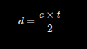
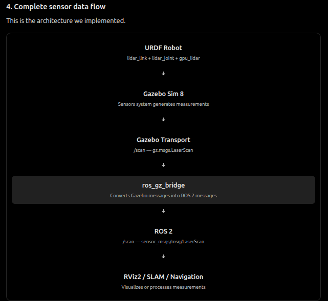
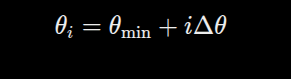
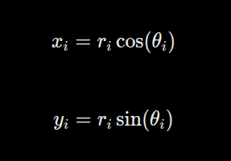
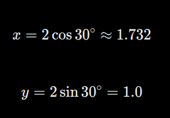

# What is LiDAR?

LiDAR stands for **Light Detection and Ranging**.

It is a sensor technology that measures the distance to surrounding objects using laser light.

[Neobotix: Mobiler Roboter MPO-500](https://images.openai.com/static-rsc-4/ozYvJDOi6xxGXFY1XyWsWINqrRvOUB4grzRyP2Msa0fY3-qhzopDdacI5N6XO9da5t8faT0QzD2dnGlas8-K5cPW3ZJEawbDLVQknF6cpQsrPwMD0GV3yIgkYgTs4xROOVAuy2AePQEU_4-fZWI-WxXFwJLk4hHzr4BwTPVNBVE?purpose=inline)

[UST-30LX | 製品一覧 | 測域センサ | データ出力タイプ | UST-30LX | 北陽電機株式会社 | 光データ装置、センサ、自動ドアなどの専門メーカー](https://images.openai.com/static-rsc-4/ysJWwgzOpuqPmV6wxh_UASm-XnWVmeBlS9ICAL-rrtDgwvT5-umZPvrM6foEDeeyEJQAlx-ec49OjROOZyve1MYn2jjowG_MeycfZrLXOvT41X3AcLQvI9Xzdx1J8lM1NCFgcJdtgfcZU6vTMdqw1q6SOvYZ7NX-VCyc6uqmdTk?purpose=inline)

[A 2D-Lidar-Equipped Unmanned Robot-Based Approach for Indoor Human Activity Detection](https://images.openai.com/static-rsc-4/3bk-6Ax2sAQ9Emw5ffARW1RI_BnaBPYqn4ojimcqrNEhORlKh_zBRXzXuyJr7I8FC5cHA39yBkUi8LqT6YJ4--nK-updPH7OwicAiWEqzKdqjflS_3hIcdJh7v42ADNtvcLkWkSuwmQgV8qaLKZ8RjiQeGJEIvHfsyt0gXPh5PI?purpose=inline)

### **How LiDAR works**

1. The LiDAR emits laser light.
    
2. The light interacts with surrounding objects.
    
3. Reflected light returns to the sensor.
    
4. The sensor estimates the distance.
    
5. Measurements are collected across multiple directions.
    

For a time-of-flight LiDAR:



Where:

- \(d\) = distance to the object
    
- \(c\) = speed of light, approximately \(3\times10^8\) m/s
    
- \(t\) = round-trip travel time
    

The distance is divided by two because light travels from the sensor to the object and back.

### **Types of LiDAR**

|Type|Description|Application|
|---|---|---|
|2D LiDAR|Measures distances in a scanning plane|Mobile robots, SLAM|
|3D LiDAR|Produces spatial point clouds|Autonomous vehicles, mapping|
|Solid-state LiDAR|Uses limited or no macroscopic mechanical scanning|Automotive and robotics|

In our project, we simulated a **360° 2D LiDAR** using Gazebo's `gpu_lidar` sensor.

## **3. Why do robots use LiDAR?**

LiDAR helps robots understand their surroundings.

Its major applications include obstacle detection, mapping, localization, navigation, and SLAM.

For example, a warehouse robot can use LiDAR measurements to detect racks and walls, estimate its position on a map, and support obstacle-aware navigation.

LiDAR does not independently make a robot autonomous. Its measurements must be processed by localization, mapping, planning, and control software.


## **4. Complete sensor data flow**


### **Important distinction**

Gazebo and ROS 2 have separate communication systems.

|Gazebo|ROS 2|
|---|---|
|Gazebo Transport|DDS-based ROS 2 communication|
|`gz.msgs.LaserScan`|`sensor_msgs/msg/LaserScan`|
|`gz topic -l`|`ros2 topic list`|
|`gz topic -e -t /scan`|`ros2 topic echo /scan`|

**Why is** `ros_gz_bridge` **required?**

Gazebo publishes sensor measurements using Gazebo message types. ROS 2 nodes cannot directly subscribe to those messages.

The bridge converts and forwards the messages so ROS 2 applications can use them.

# **Part 3 — URDF LiDAR Configuration**

## **5. Adding a LiDAR sensor to the robot**

Our robot description is stored at:

```
/ros2_ws/src/robot_description/urdf/my_robot_generated.urdf
```

We added three main components:

- `lidar_link` — the sensor's physical and coordinate-frame representation.
    
- `lidar_joint` — attaches the sensor to the robot.
    
- Gazebo sensor definition — generates simulated LiDAR data.
    

### **5.1 LiDAR link**

```xml
<link name="lidar_link">
  <visual>
    <geometry>
      <cylinder radius="0.05" length="0.04"/>
    </geometry>
    <material name="lidar_black">
      <color rgba="0.1 0.1 0.1 1"/>
    </material>
  </visual>

  <inertial>
    <mass value="0.1"/>
    <inertia
      ixx="0.00005" ixy="0" ixz="0"
      iyy="0.00005" iyz="0"
      izz="0.000125"/>
  </inertial>
</link>
```

The visual geometry represents a small cylindrical sensor mounted on the robot.

The inertial properties describe its approximate mass and rotational inertia for simulation.

### **5.2 Fixed joint**

```xml
<joint name="lidar_joint" type="fixed">
  <parent link="base_link"/>
  <child link="lidar_link"/>
  <origin xyz="0 0 0.2" rpy="0 0 0"/>
</joint>
```

**Explanation:**

|Element|Meaning|
|---|---|
|`parent`|Robot's base link|
|`child`|LiDAR link|
|`fixed`|No relative movement|
|`xyz`|Position relative to the parent|
|`rpy`|Roll, pitch, yaw orientation|

Here, the LiDAR is positioned 0.2 metres above the `base_link` origin.

This joint also establishes the fixed transform:

```
base_link
    |
    └── lidar_link
```

### **5.3 Gazebo sensor definition**

```xml
<gazebo reference="lidar_link">
  <sensor name="lidar_sensor" type="gpu_lidar">
    <always_on>true</always_on>
    <update_rate>10</update_rate>
    <topic>scan</topic>
    <gz_frame_id>lidar_link</gz_frame_id>

    <lidar>
      <scan>
        <horizontal>
          <samples>360</samples>
          <resolution>1</resolution>
          <min_angle>-3.14159</min_angle>
          <max_angle>3.14159</max_angle>
        </horizontal>
      </scan>

      <range>
        <min>0.12</min>
        <max>8.0</max>
        <resolution>0.01</resolution>
      </range>
    </lidar>
  </sensor>
</gazebo>
```

### **Sensor parameters**

|Parameter|Configured value|Purpose|
|---|---|---|
|Sensor type|`gpu_lidar`|GPU-based ray scanning|
|Update rate|10 Hz|Ten scans per simulation second|
|Samples|360|Angular samples|
|Minimum angle|-180°|Beginning of scan|
|Maximum angle|+180°|End of scan|
|Minimum range|0.12 m|Closest measurable distance|
|Maximum range|8.0 m|Maximum measurable distance|
|Topic|`/scan`|Sensor output topic|
|Frame|`lidar_link`|Sensor coordinate frame|

### **Why GPU LiDAR?**

Gazebo's GPU LiDAR uses rendering-based ray simulation to estimate distances to surrounding geometry.

It is useful for simulated perception systems, especially when many rays must be processed.

The exact performance depends on GPU drivers, rendering configuration, and simulation complexity.

# **Part 4 — Gazebo World Configuration**

## **6. The problem we encountered**

Initially, we launched:

```
gz sim -r empty.sdf
```

Our robot spawned successfully, but:

```
gz topic -l
```

did not display `/scan`.

We verified that the URDF contained:

```
lidar_link
lidar_joint
lidar_sensor
gpu_lidar
```

This indicated that the sensor was defined, but the simulation was not producing its scan topic.

### **Root cause**

The working fix was to create a custom Gazebo world that explicitly loads the **Sensors system**.

The Sensors system is responsible for updating simulated sensors such as LiDAR and cameras.

## **7. Creating the custom world**

Our world file:

```
/ros2_ws/worlds/lidar_world.sdf
```

Create or edit it using:

```
mkdir -p /ros2_ws/worlds
nano /ros2_ws/worlds/lidar_world.sdf
```

### **Essential Gazebo systems**

```xml
<plugin filename="gz-sim-physics-system"
        name="gz::sim::systems::Physics"/>

<plugin filename="gz-sim-user-commands-system"
        name="gz::sim::systems::UserCommands"/>

<plugin filename="gz-sim-scene-broadcaster-system"
        name="gz::sim::systems::SceneBroadcaster"/>

<plugin filename="gz-sim-sensors-system"
        name="gz::sim::systems::Sensors">
  <render_engine>ogre2</render_engine>
</plugin>
```

|System|Function|
|---|---|
|Physics|Gravity, collisions, dynamics|
|UserCommands|Spawn, remove, and modify entities|
|SceneBroadcaster|Publishes scene information for visualization|
|Sensors|Updates simulated LiDAR and other sensors|

The most important plugin for this lesson was:

```xml
<plugin
  filename="gz-sim-sensors-system"
  name="gz::sim::systems::Sensors">
  <render_engine>ogre2</render_engine>
</plugin>
```

Without a functioning Sensors system, a valid LiDAR sensor definition may not generate measurements.

## **8. Second problem — Missing Gazebo models**

Our first custom world attempted to load:

```xml
<include>
  <uri>model://ground_plane</uri>
</include>

<include>
  <uri>model://sun</uri>
</include>
```

Gazebo reported:

```
Error Code 14:
Unable to find uri[model://ground_plane]

Unable to find uri[model://sun]
```

### **Why?**

Gazebo could not resolve those model resources in its configured resource paths.

### **Solution**

We replaced the external model references with definitions directly inside the world file.

For the ground:

```xml
<model name="ground_plane">
  <static>true</static>
  <link name="ground_link">
    <collision name="collision">
      <geometry>
        <plane>
          <normal>0 0 1</normal>
          <size>100 100</size>
        </plane>
      </geometry>
    </collision>
    <visual name="visual">
      <geometry>
        <plane>
          <normal>0 0 1</normal>
          <size>100 100</size>
        </plane>
      </geometry>
    </visual>
  </link>
</model>
```

We also defined a directional light directly in the SDF file.

This eliminated the dependency on external `model://` resources.

## **9. Adding an obstacle**

We added a static box to test LiDAR detection:

```xml
<model name="obstacle_box">
  <static>true</static>
  <pose>2 0 0.5 0 0 0</pose>

  <link name="box_link">
    <collision name="collision">
      <geometry>
        <box>
          <size>1 1 1</size>
        </box>
      </geometry>
    </collision>

    <visual name="visual">
      <geometry>
        <box>
          <size>1 1 1</size>
        </box>
      </geometry>
    </visual>
  </link>
</model>
```

The box is centred at X = 2 m, Y = 0 m and Z = 0.5 m in the world coordinate frame.

Its dimensions are 1 × 1 × 1 m.

As the robot approaches the box, the LiDAR should measure decreasing distances to its visible surface.

# **Part 5 — Complete Startup Commands**

These are the commands to start your working simulation from a fresh terminal session.

## **Terminal 1 — Start Gazebo**

```
source /opt/ros/jazzy/setup.bash
source /ros2_ws/install/setup.bash

gz sim -r /ros2_ws/worlds/lidar_world.sdf
```

The `-r` flag starts the simulation running rather than paused.

## **Terminal 2 — Start robot_state_publisher**

```
source /opt/ros/jazzy/setup.bash
source /ros2_ws/install/setup.bash

ros2 run robot_state_publisher robot_state_publisher \
  --ros-args \
  -p robot_description:="$(cat /ros2_ws/src/robot_description/urdf/my_robot_generated.urdf)" \
  -p use_sim_time:=true
```

`robot_state_publisher` publishes the robot's coordinate transforms based on the robot description and joint states.

## **Terminal 3 — Spawn the robot**

```
source /opt/ros/jazzy/setup.bash
source /ros2_ws/install/setup.bash

ros2 run ros_gz_sim create \
  -world empty \
  -topic robot_description \
  -name my_robot \
  -z 0.2
```

This creates the robot inside the running Gazebo world.

The `-z 0.2` argument specifies the initial spawn height, which may need adjustment for the robot's physical geometry.

## **Terminal 4 — Activate controllers**

```
source /opt/ros/jazzy/setup.bash
source /ros2_ws/install/setup.bash

ros2 run controller_manager spawner \
  joint_state_broadcaster \
  --controller-manager /controller_manager
```

Then:

```
ros2 run controller_manager spawner \
  diff_drive_controller \
  --controller-manager /controller_manager
```

Verify:

```
ros2 control list_controllers
```

Expected:

```
joint_state_broadcaster ... active
diff_drive_controller  ... active
```

## **Terminal 5 — Bridge Gazebo and ROS 2**

```bash
source /opt/ros/jazzy/setup.bash
source /ros2_ws/install/setup.bash

ros2 run ros_gz_bridge parameter_bridge \
  '/scan@sensor_msgs/msg/LaserScan[gz.msgs.LaserScan' \
  '/clock@rosgraph_msgs/msg/Clock[gz.msgs.Clock'
```

This forwards the LiDAR measurements and simulation clock from Gazebo to ROS 2.

Keep this terminal running.

## **Terminal 6 — Open RViz2**

```
source /opt/ros/jazzy/setup.bash
source /ros2_ws/install/setup.bash

rviz2 --ros-args -p use_sim_time:=true
```

Configure RViz2:

- Fixed Frame: `lidar_link` initially, then `odom`.
    
- Add `LaserScan`, Topic: `/scan`.
    
- Add `TF`.
    
- Add `RobotModel`.
    

## **Terminal 7 — Keyboard teleoperation**

```
source /opt/ros/jazzy/setup.bash
source /ros2_ws/install/setup.bash

ros2 run teleop_twist_keyboard teleop_twist_keyboard \
  --ros-args \
  -p stamped:=true \
  -r /cmd_vel:=/diff_drive_controller/cmd_vel
```

Your differential-drive controller uses `TwistStamped`, so `stamped:=true` is necessary.


## **10. What is** `sensor_msgs/msg/LaserScan`**?**

This ROS 2 message represents range measurements taken at different angles in a scanning plane.

Inspect its definition:

```
ros2 interface show sensor_msgs/msg/LaserScan
```

Read a scan:

```
ros2 topic echo /scan --once
```

Example output (illustrative):

```yaml
header:
  stamp:
    sec: 120
    nanosec: 0
  frame_id: lidar_link

angle_min: -3.14159
angle_max: 3.14159
angle_increment: 0.01745

time_increment: 0.0
scan_time: 0.1

range_min: 0.12
range_max: 8.0

ranges:
- 2.5
- 2.4
- 2.3
- 2.2

intensities: []
```

### **Important fields**

|Field|Explanation|
|---|---|
|`header.stamp`|Timestamp of the scan|
|`header.frame_id`|Sensor coordinate frame|
|`angle_min`|Starting scan angle|
|`angle_max`|Ending scan angle|
|`angle_increment`|Angular spacing between readings|
|`scan_time`|Time between scans|
|`range_min`|Minimum valid distance|
|`range_max`|Maximum valid distance|
|`ranges`|Array of distance measurements|
|`intensities`|Optional returned signal intensities|

### **Calculating the angle of a reading**

For range index \(i\):



For a 360-sample scan covering approximately 360°, the angular spacing is roughly 1°.

### **Converting polar coordinates to Cartesian coordinates**

For each valid distance \(r_i\):


These coordinates are relative to the LiDAR sensor frame.

For example, a measurement of 2 m at 30° gives:


This is one of the basic calculations used in robotics perception.

## **11. Why are coordinate frames important?**

The LiDAR measures distances relative to its own coordinate frame.

However, RViz2 may need to display those measurements relative to the robot or the world.

Our relevant TF chain is:

```
odom
  |
  └── base_link
        |
        └── lidar_link
```

The odometry transform changes as the robot moves.

The transform from `base_link` to `lidar_link` is fixed because the sensor is rigidly mounted.

Check:

```
ros2 run tf2_ros tf2_echo base_link lidar_link
```

The expected translation is approximately:

```
Translation: [0.0, 0.0, 0.2]
```

This assumes the sensor mounting position from our URDF example.

### **RViz Fixed Frame**

|Fixed Frame|What it means|
|---|---|
|`lidar_link`|Visualize measurements relative to the sensor|
|`base_link`|Visualize relative to the robot body|
|`odom`|Visualize relative to the odometry frame|
|`map`|Visualize relative to a map, once SLAM or localization provides it|

For initial LiDAR testing, `lidar_link` is convenient because it avoids requiring additional TF transforms.

For moving-robot visualization, `odom` is more useful.


## **12. Errors we encountered and their solutions**

|Problem|Cause|Solution|
|---|---|---|
|`/scan` missing|Gazebo sensor system not active|Add `gz-sim-sensors-system`|
|`model://ground_plane` missing|Resource URI could not be resolved|Define ground directly in SDF|
|`model://sun` missing|Resource URI could not be resolved|Define directional light in SDF|
|`gz_frame_id` warning|Element not recognized by the SDF schema validator|Check sensor frame handling; warning was not fatal|
|Robot not visible|Robot not spawned or publisher unavailable|Start publisher, then spawn|
|Controllers inactive|Controllers not spawned or configured|Use controller spawner|
|RViz scan not visible|Missing TF, wrong Fixed Frame, or missing bridge|Check frame, `/scan`, and TF|
|Scan not updating|Simulation paused or sensor not updating|Resume Gazebo and check sensor topics|

### **Essential diagnostic commands**

```bash
# List Gazebo topics
gz topic -l

# List models in Gazebo
gz model --list

# Check Gazebo LiDAR data
gz topic -e -t /scan

# List ROS 2 topics
ros2 topic list

# Check ROS 2 LiDAR data
ros2 topic echo /scan --once

# Check LiDAR frequency
ros2 topic hz /scan

# Check active controllers
ros2 control list_controllers

# Check LiDAR TF
ros2 run tf2_ros tf2_echo base_link lidar_link

# Check odometry
ros2 topic echo /diff_drive_controller/odom --once

# Check simulation clock
ros2 topic echo /clock --once
```

### **Recommended debugging order**

1. Is Gazebo running and unpaused?
2. Is my_robot spawned?
3. Does the URDF contain the LiDAR sensor?
4. Is the Gazebo Sensors system loaded?
5. Does gz topic -l show /scan?
6. Does gz topic -e -t /scan produce data?
7. Is ros_gz_bridge running?
8. Does ROS 2 receive /scan?
9. Are the TF frames connected?
10. Does RViz2 display the scan?

**Industry practice:** Debug from the data source toward the consumer. Verify Gazebo first, then the bridge, then ROS 2, then TF and RViz2. This helps isolate failures efficiently.


## **13. Where is this used in industry?**

[HECTOR - Robot AMR autonome longue autonomie et IP68 | AI Robotics France](https://images.openai.com/static-rsc-4/AH4SzlED7v5Zsxd61fFDquoIIZkq4mss2oWwUVVbwjOkekn3lFGxxyuUsGek7cOsxcZII_Gp_m5oB3Lj_RQtXupmgDUWbsgoLxWnZUHfOD8SQE4ujrqOoGazHeTh1QWzytXKidOeHlWaX--NzynOb3oROulNeXX3vRqC6RKhrgk?purpose=inline)

**Autonomous Mobile Robots (AMRs)**

LiDAR supports localization, mapping, and obstacle detection in warehouses and factories.

[Different SLAM approaches from “the box” in reality. | by Love Robots to Death | Medium](https://images.openai.com/static-rsc-4/mF6p7E8dGxZTaEheFSyBS0pB6YMQ4qZsgGr397Xwcf2d4UEtlujfdD-IsbH78NUHRBIYr7UBMzYlZG5ut7dikezcn2pAmnjoicXyTJH486yxh4rhqcGWtmOUTJd8WTeQv10WqTVgFbVLUsDANxLme66JohVxUMvsf1Yt1UydBXg?purpose=inline)

**SLAM systems**

LiDAR scans and odometry are combined to build maps and estimate robot position in previously unknown environments.

[Serve Gen3 by Serve Robotics — ui44](https://images.openai.com/static-rsc-4/Zm6_uoRAOurQREn709PTyautqhm5TZjINFnFIqtTVuVQGRTQ_RhHhGWwfN5J-V3buz2W4eWVt77yRtopBs6JuiLurXt3c1HQWGPidzm0Ie9mzFvZQSXIfaBED3epfzgQmLd82c-kPhFd4Od7ViFxEnlOhdNpNGACjebEvpxZ01Y?purpose=inline)

**Autonomous delivery and service robots**

Range sensing helps detect nearby structures and obstacles during navigation.

### **Industry-standard ROS 2 tools**

|Tool|Purpose|
|---|---|
|Gazebo Sim|Physics and sensor simulation|
|URDF/Xacro|Robot description|
|`ros_gz_bridge`|Gazebo–ROS 2 communication|
|`robot_state_publisher`|Robot coordinate transforms|
|`tf2`|Transform management|
|RViz2|Visualization and debugging|
|`slam_toolbox`|2D SLAM|
|Nav2|Autonomous navigation|

For real industrial deployment, sensor calibration, timestamp synchronization, reliability monitoring, and appropriate safety-rated systems are also important.

# **Part 10 — Key Concepts to Remember**

1. **URDF describes the robot**, including its links, joints, and Gazebo sensor definitions.
    
2. **Gazebo simulates the sensor**, generating measurements from the virtual environment.
    
3. **The Sensors system must be active** for our GPU LiDAR configuration to work.
    
4. `/scan` **in Gazebo is not automatically** `/scan` **in ROS 2.** We need `ros_gz_bridge`.
    
5. `LaserScan` **stores ranges and angles**, not a ready-made map.
    
6. **TF connects sensor measurements to the robot's coordinate system.**
    
7. **RViz2 visualizes measurements** but does not itself generate or process LiDAR scans.
    
8. **Odometry and LiDAR complement each other:** odometry estimates robot motion, while LiDAR observes surrounding geometry.
    
9. **SLAM combines sensor observations and motion estimates** to build a map and estimate pose.
    
10. **Simulation is a development and testing tool**, but real-world deployment requires additional sensor and safety consideratio

---

[Back to the learning path](../README.md)
